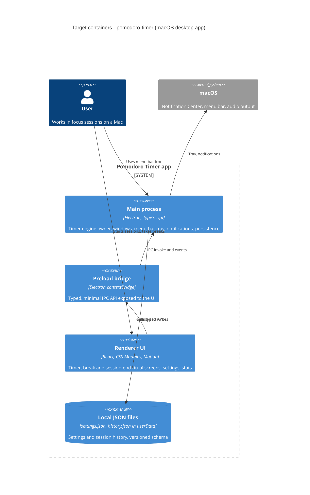

# Architecture map — pomodoro-timer

> **Greenfield foundation.** No application code exists yet. This map describes the **target
> baseline** that `scaffold` materializes, and the conventions every feature follows. It was chosen
> with the owner in the greenfield session (guided-default mode, bundle confirmed 2026-10-31). The
> intent comes from [idea-brief.md](idea-brief.md). Refresh with `survey` once code lands.

## Stack

- **Language / runtime:** TypeScript (`strict`) on Node 24. The local machine runs v24.11.1. The
  Electron version is pinned at scaffold time to the latest stable release.
- **Frameworks:** Electron (desktop shell), React (renderer UI), Motion (React animation library).
- **Build / packaging:** electron-vite (dev server + bundling for main / preload / renderer),
  electron-builder (unsigned macOS `.dmg` for v1, see [ADR-0001](adr/0001-build-on-electron-react-typescript.md)).
  Package manager: npm.
- **Build / test / lint:** `npm run build` · `npm test` (Vitest) · `npm run lint` (ESLint) ·
  `npm run typecheck` (`tsc --noEmit`) · `npm run test:e2e` (Playwright for Electron, boot smoke test).
- **Pipeline references:** ADRs live in `docs/adr/`. The scaffold plan is
  `docs/features/_scaffold/tasks.json`.

## C4 — system as it is

Target baseline. Nothing below exists yet; `scaffold` creates it.

## Module inventory

| Module | Path | Layers | Wired at | Responsibility |
|---|---|---|---|---|
| shared | `src/shared/` | domain (pure TS, no Electron/DOM imports) | imported by main and renderer | Timer state machine (phases, transitions, remaining-time math from timestamps), domain types, the IPC channel contract |
| main | `src/main/` | app (lifecycle, timer service) · infra (windows, tray, notifications, JSON store) · ports (IPC handlers) | `src/main/index.ts` (entry, to be created) | Owns the single running timer ([ADR-0002](adr/0002-run-the-timer-engine-in-the-main-process.md)), shows the session-end window, drives tray and notifications, persists data |
| preload | `src/preload/` | ports | `src/preload/index.ts` (to be created) | Exposes `window.api`, a typed wrapper over the shared IPC contract. No business logic |
| renderer | `src/renderer/` | ui (screens, components, hooks) | `src/renderer/src/main.tsx` (to be created) | Renders the state pushed from main. Owns all visuals and animation |

## Conventions (cited — the rules a new feature must match)

There is no code to cite yet. Each convention is a **decided rule**. The cited path is where
`scaffold` creates its first instance.

- **Module wiring / registration:** main registers each IPC handler in one place
  (`src/main/ipc.ts`). Channel names and payload types come only from `src/shared/ipc.ts`, so main
  and renderer never hand-write channel strings.
- **Process boundary:** the renderer has `contextIsolation: true`, `nodeIntegration: false` and
  `sandbox: true`. It reaches the system only through `window.api` (`src/preload/index.ts`).
- **Timer truth:** the timer state lives in main. Remaining time is derived from stored timestamps
  (`startedAt`, `pausedAt`, duration), never from counting ticks. The renderer only displays it
  (`src/shared/timer.ts`).
- **Error handling:** `src/shared` domain functions are pure and return results without throwing for
  expected cases. IPC handlers in main catch unexpected errors, log them, and return a typed
  `{ ok: false, error }` result (`src/shared/ipc.ts`).
- **IDs:** `crypto.randomUUID()` for session-history records. Ordering comes from the `startedAt`
  timestamp.
- **Persistence:** main owns the JSON files in `app.getPath('userData')`, through one store module
  (`src/main/store.ts`). Writes are atomic: write a temp file, then rename. See
  [ADR-0003](adr/0003-persist-data-as-versioned-local-json.md).
- **Migrations:** each file carries `schemaVersion`. Upgrades are pure functions
  `migrate_vN_to_vN+1` in `src/main/store/migrations.ts`, run on load. There is no external
  migration tool, so `migration_tool` is `""`.
- **Tests:** Vitest. Each test file sits next to its subject as `*.test.ts(x)`. Domain logic is
  unit-tested with fake timers. Renderer components use Testing Library and jsdom. A Playwright
  `_electron` boot smoke test lives in `e2e/`.
- **Lint / format:** ESLint flat config with typescript-eslint, plus Prettier. `tsc --noEmit` is the
  vet gate.
- **Inter-module communication:** renderer → main uses `ipcRenderer.invoke` (request/response).
  main → renderer uses a `timer:state` event broadcast to every open window.
- **UI / styling:** CSS Modules per component, and design tokens as CSS custom properties in
  `src/renderer/src/styles/tokens.css`. Animations use Motion. Every animation honors
  `prefers-reduced-motion`. Details in §Frontend / UI foundation.
- **CI:** one GitHub Actions workflow on `macos-latest` (`.github/workflows/ci.yml`) runs install,
  typecheck, lint, test and build.

## Datastores

| Store | Engine | Accessed via | Notes |
|---|---|---|---|
| Settings | `settings.json` in userData | `src/main/store.ts` | Durations, sound choices, preferences. Versioned with `schemaVersion` |
| Session history | `history.json` in userData | `src/main/store.ts` | Completed sessions for local statistics. No sync (idea-brief §5) |

## Frontend / UI foundation

There is no UI yet. These are the target foundations every `ui`-layer task builds on, not
replaces.

- **Component library / design system:** an in-repo kit in `src/renderer/src/components/ui/`.
  There is no third-party component kit: the product's purpose is a distinctive look.
- **Design tokens:** `src/renderer/src/styles/tokens.css` defines CSS custom properties for color
  palette (light and dark), spacing, radii, typography and motion durations/easings.
- **Styling approach:** CSS Modules (`*.module.css`). This is the only styling approach. No
  Tailwind and no CSS-in-JS.
- **Shared primitives:** none yet. The first features create them in `components/ui/`, for example
  Button, the timer dial and the screen transition.
- **State / data-fetching:** a `useTimerState()` hook subscribes to the `timer:state` event from
  `window.api`. There is no global store library until one is needed.
- **Closest UI precedent:** none yet. The first screen built becomes the precedent.

## Where things live / closest precedents

- **A new timer rule** (phases, cycle counting): `src/shared/timer.ts` with a unit test alongside.
  Main applies the rule, the renderer only displays it.
- **A new system integration** (tray, notification, window behavior): `src/main/`, exposed to the
  UI only through `src/shared/ipc.ts` and `src/preload/index.ts`.
- **A new screen / UI component:** `src/renderer/src/screens/` or `components/`. It is composed
  from `components/ui/` and `tokens.css`.
- **New persisted data:** a field in the settings or history schema, a `schemaVersion` bump, and a
  migration function with a test.

## Constraints & known tech-debt

- **macOS-first** (idea-brief §5): Windows and Linux are deferred, though the Electron foundation
  keeps them possible.
- **Unsigned v1** (idea-brief §7): electron-builder produces an unsigned `.dmg`. Notarization
  would need a paid Apple Developer membership and is deferred.
- **Native notifications cannot be styled** (idea-brief §6 ledger): the session-end ritual is the
  app's own window. The `Notification` API is only the fallback signal.
- **Open-source distribution**: bundled audio and other assets must be redistributable under the
  repo's license, which is not chosen yet (idea-brief §8).
- **No authored architecture docs; nothing to work around yet.**

## Reconciliation with the authored architecture doc

There is no authored architecture doc. This map is the current reference. The foundational
decisions are recorded in [ADR-0001](adr/0001-build-on-electron-react-typescript.md),
[ADR-0002](adr/0002-run-the-timer-engine-in-the-main-process.md) and
[ADR-0003](adr/0003-persist-data-as-versioned-local-json.md).
