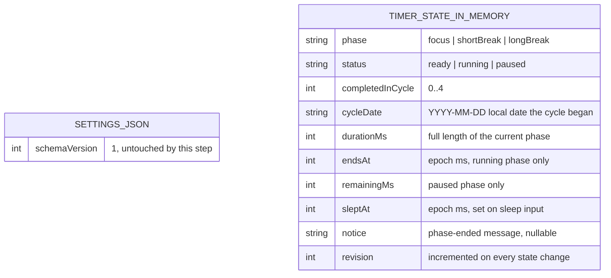

# Data model — focus-timer-core

> **Outcome: no schema change.** This step persists nothing (spec §3 non-goal «Surviving a quit or
> restart»; [sad.md](sad.md) §4 choice 5, §8 *Persistence*). The timer state lives only in main's
> memory, and the existing `settings.json` store is not touched. There are **zero staged
> migrations**. This document records the store as it stands and the in-memory state shape, so
> the later persistence steps (Configurable durations, roadmap step 7; Local statistics, step 9)
> start from a known baseline.

**Store convention (followed, not chosen here):** versioned local JSON files in
`app.getPath('userData')`, accessed only through `src/main/store.ts`. Writes are atomic, each
document carries `schemaVersion`, and upgrades are pure `migrate_vN_to_vN+1` functions in
`src/main/store/migrations.ts`. There is no SQL and no external migration tool
([repo ADR-0003](../../adr/0003-persist-data-as-versioned-local-json.md); architecture-map
§Conventions, `migration_tool: ""`). A schema change in this repo would therefore be staged as a
TypeScript migration step, not as an `.up.sql` / `.down.sql` pair.

## ER diagram

The two blocks have no relationship: `SETTINGS_JSON` is the only persisted document, and
`TIMER_STATE_IN_MEMORY` is never written to disk.

## Entities

### `settings.json` (persisted, unchanged)

| Field | Type | Constraints | Notes |
|---|---|---|---|
| `schemaVersion` | `1` (integer) | required | The only field in v1. The migration chain `settingsMigrations` is empty |

**Aggregate root:** root (one document per macOS account, in that account's `userData`).
**Access patterns:** read once at launch via `createSettingsStore(dir).load()`. This feature adds
no read and no write.
**Change in this step:** none. Durations stay in `DEFAULT_TIMER_CONFIG` (25/5/15, 4) in
`src/shared/timer.ts`. Roadmap step 7 adds them here, with a `schemaVersion` bump to 2 and a
`migrate_v1_to_v2` (sad.md §11 accepted debt).

### `TimerState` (in memory only, never persisted)

Held by `src/main/timer-service.ts` and changed only by `transition()` in `src/shared/timer.ts`
([ADR-0001](adr/0001-model-timer-rules-as-a-pure-transition-function.md)). The fields above follow
the SAD and the feature ADRs: `endsAt` ([ADR-0002](adr/0002-trust-the-wall-clock-with-clamps.md)),
`sleptAt` ([ADR-0005](adr/0005-feed-sleep-and-wake-into-the-rules-from-powermonitor.md)) and
`revision` ([ADR-0008](adr/0008-target-each-command-at-the-revision-the-user-saw.md)). The others
come from the spec's rules (AC-01, AC-04, AC-06, AC-15). The exact TypeScript shape is owned by
`implement`. This table is the design intent, not a contract.

**Aggregate root:** root (one per app instance, one app instance per macOS account, AC-03).
**Lifetime:** created fresh at launch and discarded at quit or crash. `revision` restarts with it.
**Why it is not persisted:** owner decision (spec §3). A quit ends the phase uncounted, and the
next launch shows focus session 1 of 4 ready (AC-13).

## Indexes

None. A JSON store has no indexes, and no sequence in sad.md §6 reads or writes a store ("No data
store in any flow", sad.md §6 *Flagged for later stages*).

## Test fixtures

None for persistence. Timer-rule tests build `TimerState` values directly in
`src/shared/timer.test.ts` and `timer.property.test.ts`, with a simulated `now` and `localDate`.
No seed data and no PII.
