# Software Architecture Document — focus-timer-core

## 1. Introduction and goals

**Intent.** focus-timer-core gives the User a dependable cycle of focus sessions and breaks on
their own Mac. The cycle is 25-minute focus sessions, 5-minute short breaks, and a 15-minute long
break earned by the 4th completed focus session. Every phase waits as a ready phase until the User
starts it, and every phase end is signalled even when the timer window is hidden or closed. The
User can pause, reset or skip a phase and restart the cycle. Only a completed focus session
advances the cycle, so the count stays honest for the later Statistics step. Nothing about the
running timer survives a quit. This is the foundation every later roadmap step builds on: the
session-end ritual, the break ritual, configurable durations and statistics (spec §1, §2).

**Top-3 quality goals (1-liners; full scenarios in §10):**

1. **Phase-end reliability.** No phase end goes unnoticed: it is detected and signalled within the
   spec's latency target, even with the window hidden or closed.
2. **Honest cycle (command safety).** Two phases never run at once, and a focus session is never
   counted twice. Only a completed focus session advances the cycle. This holds under repeated,
   late and crossing commands.
3. **Timing accuracy.** The remaining time matches the wall clock within the spec's tolerance,
   across reopening the window and waking the Mac.

**Stakeholders.**

| Role | Interest | Sign-off owner? |
|---|---|---|
| User | Runs the working day on the timer; trusts the count and the phase-end signal | No |
| Tech Lead (Vasiliy, owner) | SAD approval; builds and maintains the app | Yes |
| Security Lead (Vasiliy) | Confirms the spec §6.1 verdict: no new authorization boundary, no personal data, no network | No |

## 2. Constraints

**Technical.**
- TypeScript 6.0.3 (`strict`) on Node 24, as pinned by `package.json` and the `scaffold` commit
  `983a5d0`.
- Electron 45.2.1 (main, preload, renderer), React 19.3.1, Motion 14.9.0. Built with electron-vite
  6.0.0 and packaged with electron-builder 26.18.0 as an unsigned macOS `.dmg`
  ([repo ADR-0001](../../adr/0001-build-on-electron-react-typescript.md)).
- The timer engine runs in the main process, and the renderer only renders its state
  ([repo ADR-0002](../../adr/0002-run-the-timer-engine-in-the-main-process.md)). This feature
  amends two points of that ADR's context (see [ADR-0002](adr/0002-trust-the-wall-clock-with-clamps.md)
  and [ADR-0009](adr/0009-hide-the-single-timer-window-on-close.md)).
- No datastore is touched. The timer state lives in memory only (spec §3: no surviving a quit).
  The existing `settings.json` store ([repo ADR-0003](../../adr/0003-persist-data-as-versioned-local-json.md))
  stays unchanged.
- Renderer hardening is fixed: `contextIsolation: true`, `nodeIntegration: false` and
  `sandbox: true`. The renderer reaches main only through `window.api`.
- Vitest 5.0.5 runs unit tests in two projects: node for `src/shared` + `src/main`, jsdom for the
  renderer. Playwright 1.64.1 drives Electron end-to-end.

**Organisational.**
- Solo owner-developer (Vasiliy). Neither the spec nor the roadmap quotes a deadline or an effort
  budget. The first public release (roadmap step 4) ships straight after this step, so the step
  gates that release.

**Conventions.**
- [CLAUDE.md](../../../CLAUDE.md) and [architecture-map.md](../../architecture-map.md)
  §Conventions apply as written: process boundary, timer truth from timestamps, IPC contract
  declared once in `src/shared/ipc.ts`, handlers registered only in `src/main/ipc.ts`,
  `Result`-wrapped handlers, `*.test.ts(x)` next to the subject, CSS Modules plus `tokens.css`,
  Motion with `prefers-reduced-motion`.
- `src/shared` stays pure: no Electron, DOM, React or `node:` imports (enforced by ESLint). As a
  result, the timer rules never call `Date.now()` themselves; time is always an input.

**Regulatory / external.**
- Spec §6.1 verdict: internal data only, no personal data, no network access, nothing persisted;
  security review N/A. The abuse-case controls are the five-command surface, ignoring commands
  that don't fit the state, revision-targeted commands, confirmed Restart cycle, and one
  instance per macOS account (§8, [ADR-0008](adr/0008-target-each-command-at-the-revision-the-user-saw.md)).
- No bundled audio or other third-party assets in this step, so the open licence question
  (idea-brief §8) is not touched.

## 3. Context and scope

The User runs the Pomodoro Timer app on their own Mac to work in timed focus sessions and breaks.
The app is fully local. Its only outside party is macOS itself, which delivers notifications,
bounces the Dock icon, reports sleep, wake and shutdown, owns the clock and time zone, and
separates macOS user accounts. There is no network, no account and no other role.

<!-- brownfield: scaffold skeleton at 983a5d0 — main window + ping IPC + versioned JSON store + Panel primitive; architecture-map.md is stale (reflects f40cbab, still lists a menu-bar tray) -->

**External systems (in / out):**

| Actor or system | Type | Interaction |
|---|---|---|
| User | Person | Starts, pauses, resets and skips phases and restarts the cycle in the timer window; reopens the window from the Dock or a notification; quits the app |
| macOS | System (external) | In: sleep / wake / shutdown events, Dock-icon and notification clicks, the wall clock and local time zone. Out: Notification Center notifications, a single Dock bounce, the native quit-confirmation dialog |

External: no network services, deliberately. Trust boundary: the renderer is treated as
untrusted input. Main validates every command (§8), because spec §6.1 assumes a compromised or
buggy window.

**C4 Context (L1):**

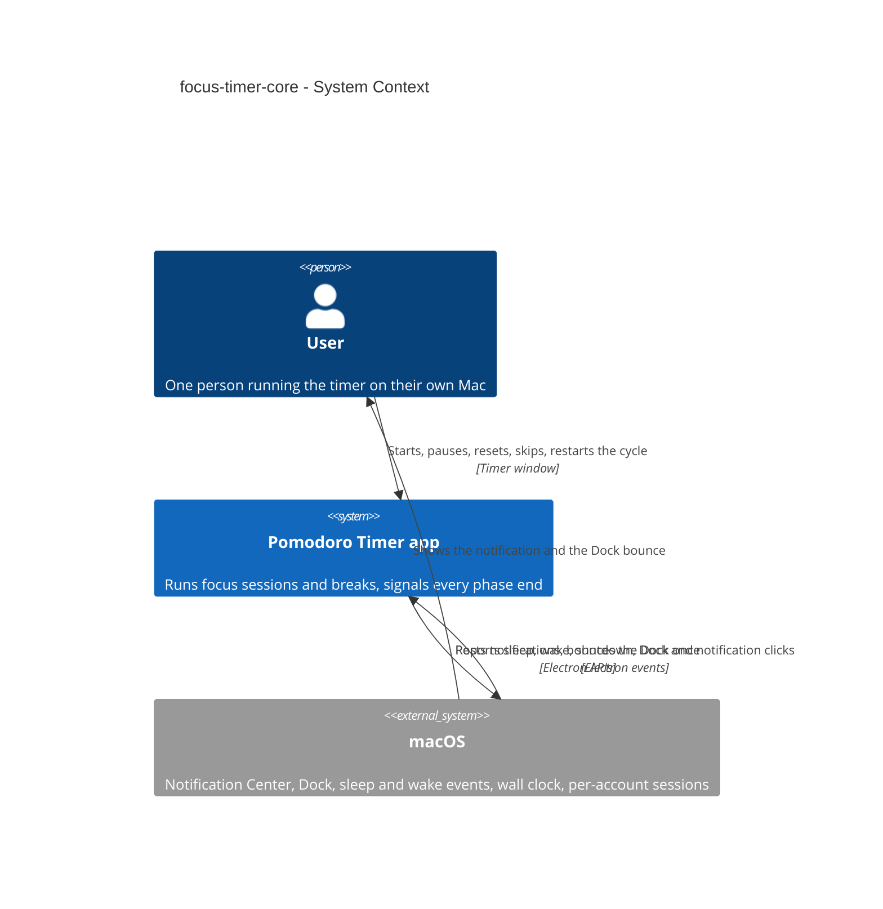

## 4. Solution strategy

**Target surface: `desktop-app`.** The feature is used by one person on their own Mac (spec §1,
§4: the User is the only role), through one timer window and the Dock. It is a single surface, and
the stack is already fixed by [repo ADR-0001](../../adr/0001-build-on-electron-react-typescript.md),
so no ADR is needed. There is no backend, CLI, worker or SDK.

**UI architecture (desktop-app, inline: below the ADR gate).** This reuses the scaffolded
foundation unchanged. A sandboxed React renderer shows one timer screen: no router and no state
library. A `useTimerState()` hook pulls a snapshot on mount, subscribes to `timer:state`, and
counts down locally ([ADR-0006](adr/0006-push-snapshots-on-change-and-count-down-in-the-window.md)).
Screens are composed from `src/renderer/src/components/ui/` and `tokens.css`
(architecture-map §Frontend). The Restart-cycle confirmation is an in-app dialog. The quit
confirmation is a native dialog from main, because the window may be closed (§8).

**Top strategic choices (the seeds for ADRs):**

1. **The rules are one pure transition function** ([ADR-0001](adr/0001-model-timer-rules-as-a-pure-transition-function.md)).
   `transition(state, input, now, localDate, config) → { state, effects }` lives in
   `src/shared/timer.ts`. Main is a thin imperative shell that supplies time and carries out the
   effects. This serves quality goal 2 directly: the 10,000-sequence property test runs against
   the shipping rules. It also serves goal 3: simulated-clock unit tests vary a single `now`.
2. **Time comes from the wall clock, clamped** ([ADR-0002](adr/0002-trust-the-wall-clock-with-clamps.md),
   resolves spec §8 Q1). A running phase stores `endsAt`. Remaining time is
   `clamp(endsAt − now, 0, durationMs)`, and a phase end is a transition, so a backward clock jump
   never resurrects it. Sleep counts against a running phase with no second clock. The local date
   for the new-day rule also comes from the Mac's clock.
3. **Main sleeps until the next deadline** ([ADR-0003](adr/0003-arm-one-deadline-timeout-in-main.md),
   [ADR-0004](adr/0004-disable-app-nap-in-the-app-bundle.md), resolves spec §8 Q2). Main arms one
   timeout to `min(endsAt, next local midnight)`, and the bundle opts out of App Nap so that
   timeout fires on time with the window closed. Together these serve goal 1 (≤ 1 s detection)
   without breaking the background-energy target, and without keeping the Mac awake.
4. **Sleep and system time changes are explicit inputs** ([ADR-0005](adr/0005-feed-sleep-and-wake-into-the-rules-from-powermonitor.md)).
   `powerMonitor` suspend and resume become `sleep(at)` and `wake` inputs. The rules decide
   counted / uncounted / still running from `sleptAt`, which keeps the count honest (goal 2)
   across AC-14's branches. In the same way, the macOS clock-change and time-zone-change
   notifications become a `clockChanged` input. It runs the new-day rule and re-arms the
   deadline, so the screen shows a fresh cycle before the User can act (AC-15).
5. **Nothing is persisted.** The timer state lives only in main's memory (spec §3 non-goal: a quit
   ends the phase uncounted, and the next launch starts fresh). No store file, no schema version
   and no migration are added. This is a spec decision, not an ADR.

Each tactical decision in later sections traces to one of these seeds.

## 5. Building block view

The feature follows the repo's process-layered style unchanged (CLAUDE.md, *Process boundary*).
The **pure timer rules** sit in `src/shared` and are imported by main and, for types and display
helpers, by the renderer. **Main** is an imperative shell around them: it owns the state, time,
deadlines, the window, notifications, the Dock and power events. The **preload** builds
`window.api` from the typed contract, and the **renderer** only displays snapshots and sends
commands. This is functional core / imperative shell: every rule is testable without Electron,
and every Electron call sits in a thin adapter that can be faked in a node-project test. The
feature extends the existing modules; it adds no new process or package.

**Internal decomposition** (new files ✚, extended ✎):

```
src/shared/
├── timer.ts            ✚ rules: TimerState, inputs, effects, transition(), toSnapshot(),
│                          allowedControls(), restartLoss(), DEFAULT_TIMER_CONFIG (25/5/15, 4)
├── timer.test.ts       ✚ AC-by-AC unit tests with a simulated clock
├── timer.property.test.ts ✚ 10,000 random command/event sequences (Command safety NFR)
└── ipc.ts              ✎ + timerGetState / timerCommand in InvokeContract,
                           + EventContract { timerState } + eventChannels, Api gains onTimerState
src/main/
├── index.ts            ✎ wiring: single-instance lock, window, timer service, quit guard,
│                          test-only timer config from POMODORO_TEST_TIMER_CONFIG when !app.isPackaged
├── timer-service.ts    ✚ shell: holds TimerState, feeds inputs with now/localDate, runs effects,
│                          re-arms the one deadline timeout, broadcasts snapshots
├── clock.ts            ✚ now(), localDate(), nextLocalMidnight(): the only Date access in main
├── system-events.ts    ✚ powerMonitor suspend/resume/shutdown → service inputs and the quit flag;
│                          systemPreferences clock / time-zone notifications → clockChanged
├── signals.ts          ✚ phase-end Notification (kept referenced until closed) + app.dock.bounce('informational')
├── window.ts           ✚ the single timer BrowserWindow: hide on close, show() for every reopen path
├── quit-guard.ts       ✚ before-quit: native confirmation when progress would be lost, never on shutdown/logout
└── ipc.ts              ✎ + timerGetState / timerCommand handlers, + typed broadcast()
src/preload/index.ts    ✎ + timerGetState, timerCommand, onTimerState
src/renderer/src/
├── hooks/useTimerState.ts  ✚ pull on mount + subscribe + local countdown while visible
├── screens/TimerScreen.tsx ✚ (+ .module.css, .test.tsx) phase, N of 4, countdown, notice, controls,
│                              Restart-cycle confirmation dialog
└── App.tsx             ✎ renders TimerScreen (the ping status goes away)
electron-builder.yml    ✎ mac.extendInfo: NSAppSleepDisabled: true (ADR-0004)
```

The IPC surface stays at the spec's five commands. One invoke, `timerCommand(command)`, carries
a discriminated union of `start | pause | reset | skip | restartCycle`, each with `revision` and,
for `restartCycle`, `confirmed` ([ADR-0008](adr/0008-target-each-command-at-the-revision-the-user-saw.md)).
A second invoke, `timerGetState()`, returns the current snapshot. One event, `timer:state`, carries
snapshots ([ADR-0006](adr/0006-push-snapshots-on-change-and-count-down-in-the-window.md),
[ADR-0007](adr/0007-add-a-typed-main-to-renderer-event-contract.md)). The renderer cannot set the
time, the phase or the cycle (spec §6.1). Closing the window hides it
([ADR-0009](adr/0009-hide-the-single-timer-window-on-close.md)). The existing `settings.json` store
is not touched.

**C4 Container (L2):**

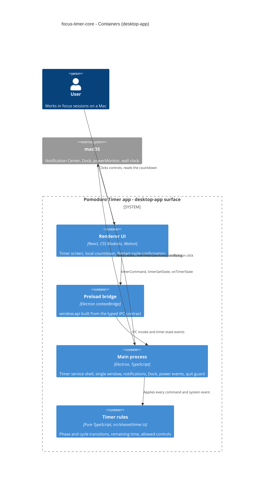

## 6. Runtime view

Two seed flows cover the critical path and the hardest branch. The `sequences` stage adds flows
until every §5 AC maps to a flow, a branch or an explicit N/A. The remaining flows include Pause
and Resume, Reset and Skip, Restart cycle with confirmation, the quit guard, the new-day rule,
and notifications blocked.

**Critical flow 1: start a focus session, and it ends with the window closed** (AC-01, AC-05,
AC-06, AC-07, AC-13)

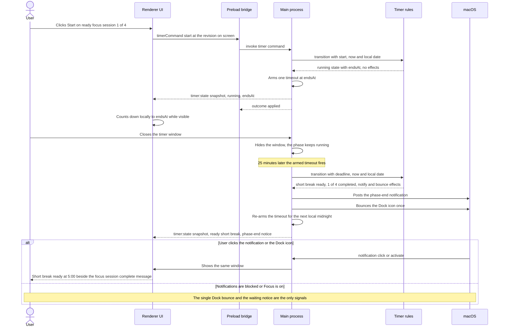

**Critical flow 2: the Mac sleeps while a focus session runs** (AC-14, AC-15)

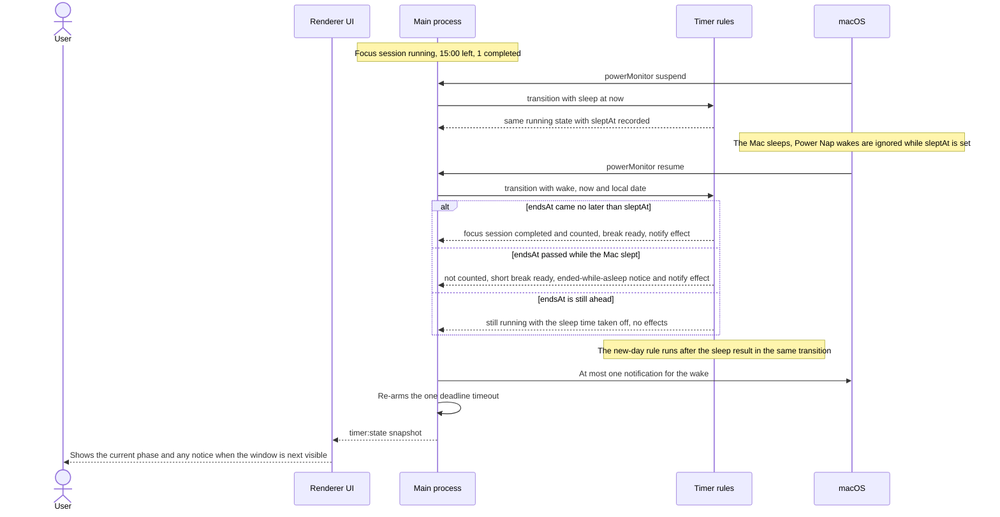

### Flow 3: launch the app (AC-01, AC-03, AC-13)

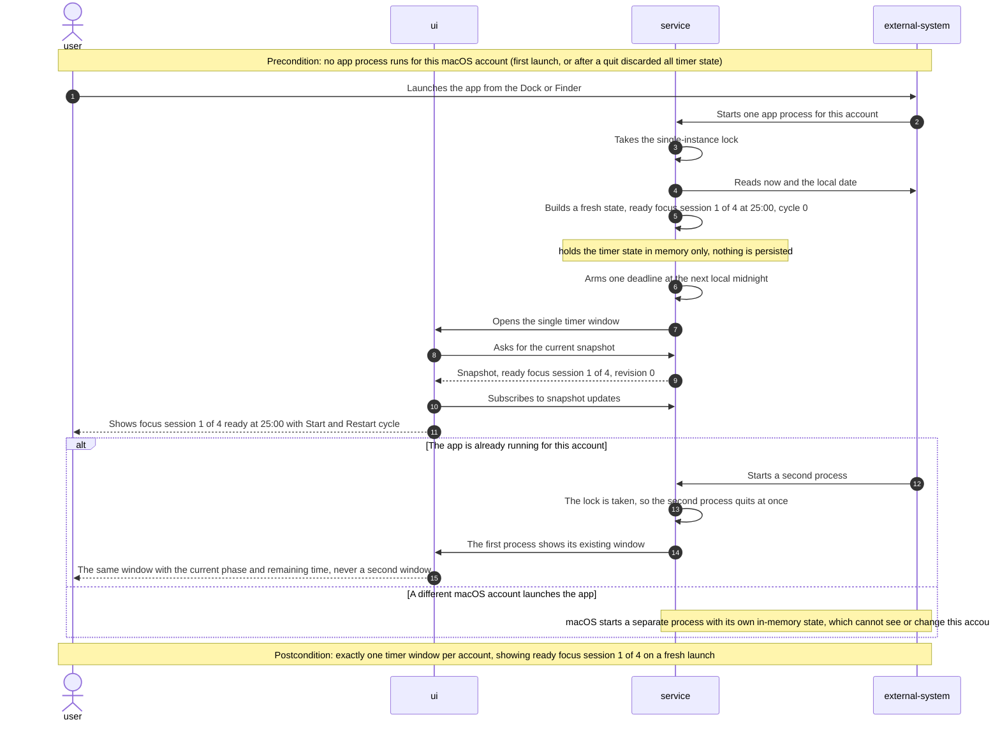

### Flow 4: pause and resume a phase, and ignore commands that don't fit (AC-02, AC-02b, AC-04)

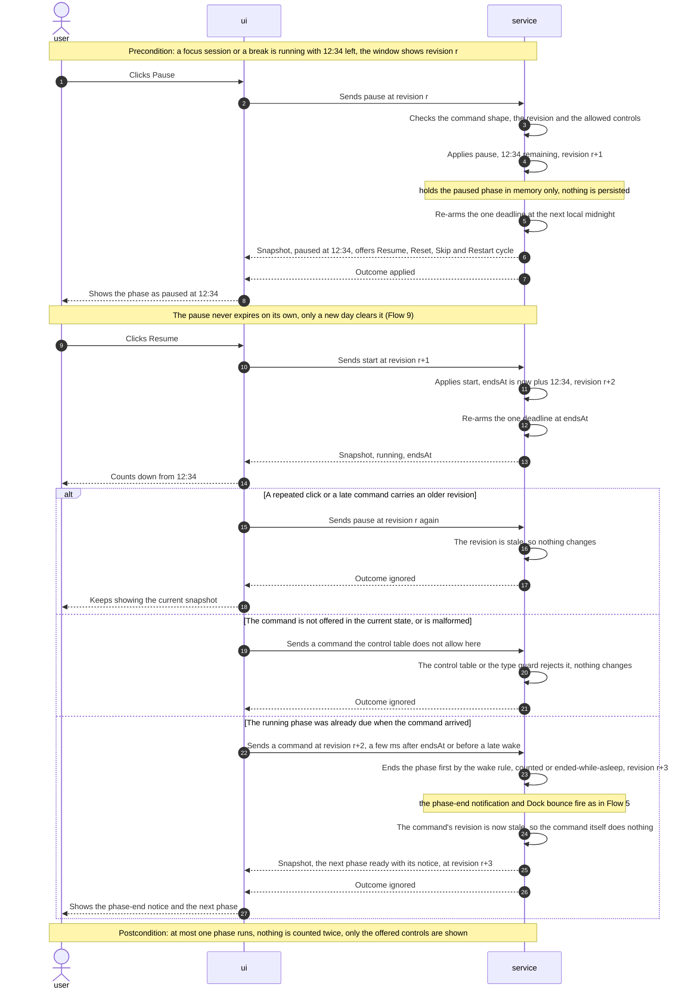

### Flow 5: a break or the 4th focus session ends (AC-05, AC-07, AC-08, AC-09)

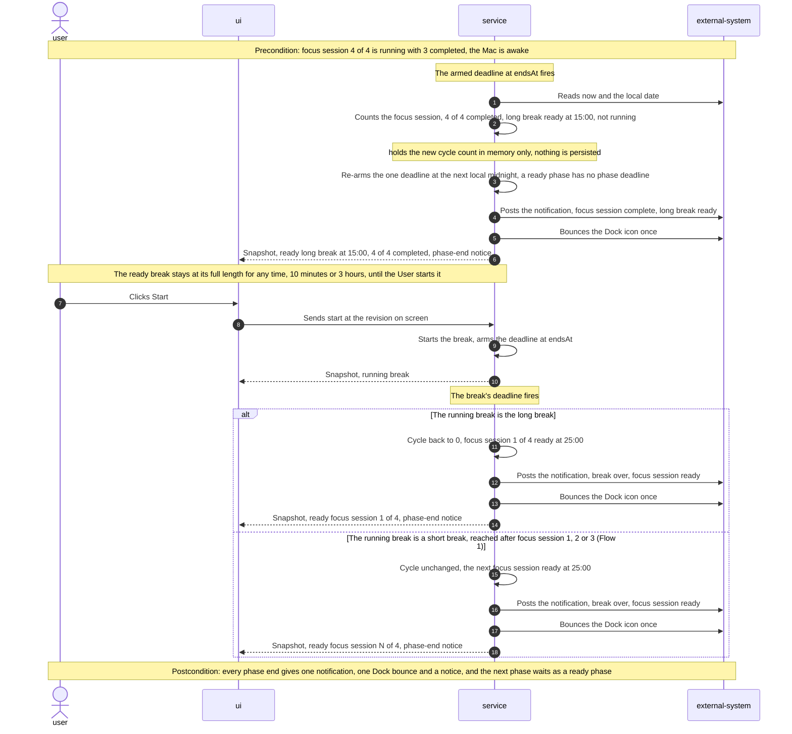

### Flow 6: reset or skip a phase (AC-02b, AC-09, AC-10, AC-11)

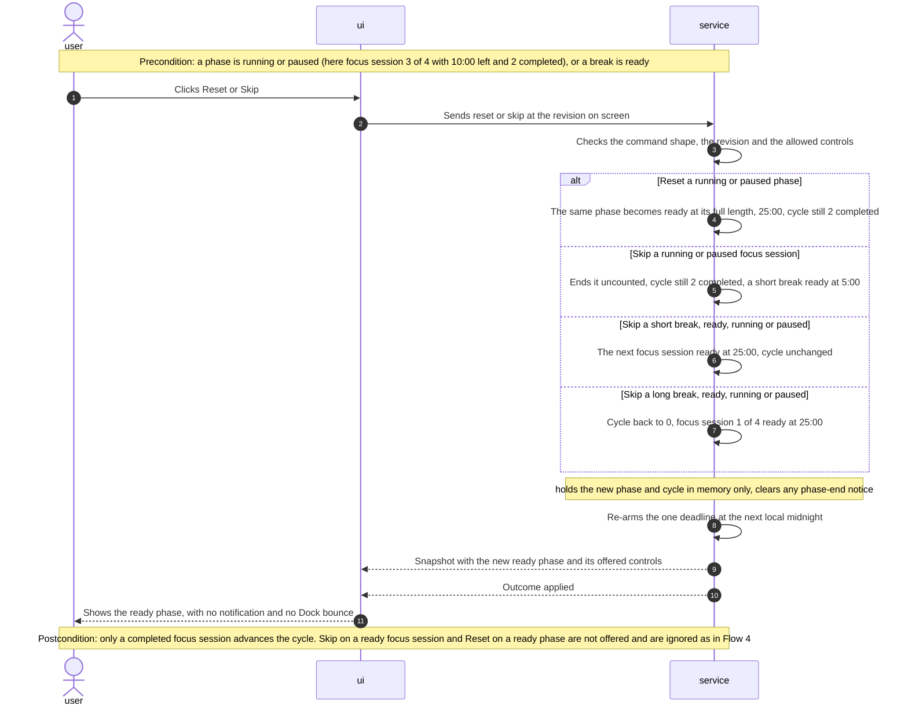

### Flow 7: restart the cycle with confirmation (AC-12)

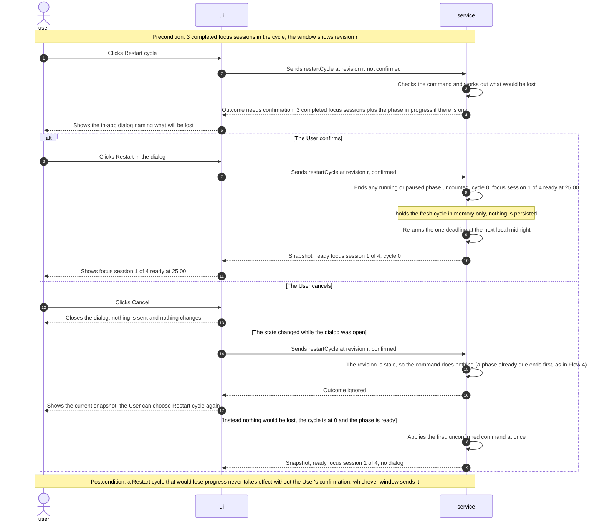

### Flow 8: quit the app with progress at stake (AC-13)

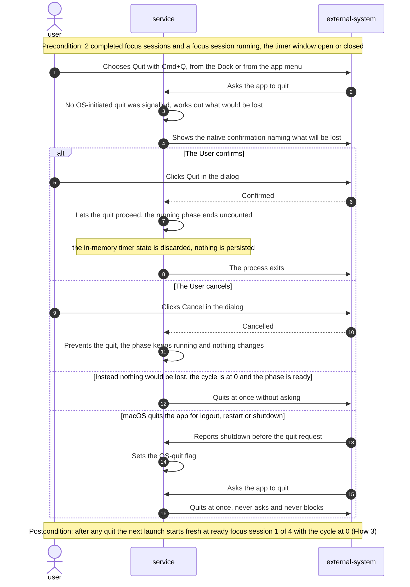

### Flow 9: a new day starts (AC-08, AC-15)

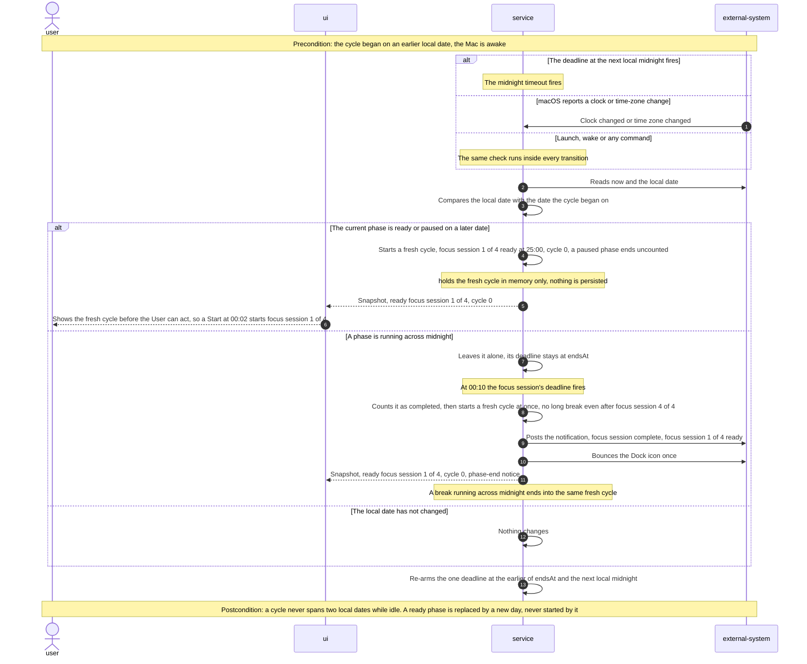

### Coverage

Flows 3–9 use the generic runtime vocabulary (`user`, `ui`, `service`, `external-system` = macOS).
The two seed flows above keep the concrete names they were drawn with at `design`.

| User story | Flows |
|---|---|
| US-01 Start a focus session | Flow 1, Flow 3, Flow 4 (resume) |
| US-02 Pause and resume | Flow 4 |
| US-03 Hear when a phase ends | Flow 1, Flow 5 |
| US-04 Start the next phase myself | Flow 1, Flow 5 |
| US-05 Earn a long break | Flow 5 |
| US-06 Reset or skip a phase | Flow 6 |
| US-07 Restart the cycle | Flow 7 |
| US-08 Close the window, keep timing | Flow 1 (close and reopen), Flow 8 (quit), Flow 3 (single window) |
| US-09 Trust the timer across sleep | Flow 2 |
| US-10 Start each day fresh | Flow 9, Flow 2 (sleep past midnight) |

| AC | Where it is shown |
|---|---|
| AC-01 | Flow 1 (start, focus session 1 of 4), Flow 3 (launch shows 1 of 4), Flow 6 (a skipped or reset focus session keeps N) |
| AC-02 | Flow 4, `alt` stale revision (repeated click, late command) |
| AC-02b | Flow 4, `else` command not offered or malformed; Flow 6 postcondition (Skip on a ready focus session, Reset on a ready phase) |
| AC-03 | Flow 3, `else` a different macOS account; by construction one process per account (§7) |
| AC-04 | Flow 4, happy path |
| AC-05 | Flow 1 (focus session ends, notification click shows the window), Flow 5 (a break ends) |
| AC-06 | Flow 1, `else` notifications blocked or Focus on; the notice rides in every snapshot |
| AC-07 | Flow 1 (focus session ends into a ready short break), Flow 5 (a break ends into a ready focus session) |
| AC-08 | Flow 5 (a ready phase arms no phase deadline), Flow 9 postcondition (a new day replaces a ready phase, never starts it) |
| AC-09 | Flow 5 (4th focus session into a long break, long break end resets the cycle), Flow 6 (`else` skip a long break) |
| AC-10 | Flow 6, `alt` Reset |
| AC-11 | Flow 6, `else` skip a focus session or a short break |
| AC-12 | Flow 7, all four branches |
| AC-13 | Flow 1 (close and reopen), Flow 8 (quit guard, OS quit), Flow 3 (next launch is fresh, never a second window) |
| AC-14 | Flow 2 |
| AC-15 | Flow 9 (midnight, clock change, command), Flow 2 (sleep past midnight) |

**Flagged for later stages (not decided here):**

- **No data store in any flow.** Every state change is held in main's memory only (spec §3). No
  new entity, column or index, so `data-model` has no schema change to make.
- **No async flow.** Deadlines, power events and clock notifications are in-process callbacks in
  main, not a queue or a third-party callback. They need no idempotency key, retry or dead-letter
  branch. Stale and repeated commands are absorbed by the revision check (ADR-0008).
- **Reset and Skip give no notification and no Dock bounce** (Flow 6). The spec ties signals only
  to a phase ending on time (AC-05, AC-06). This is worth a line in the spec at the next `clarify`.
- **What the window does when a confirmed Restart cycle comes back ignored** (Flow 7, stale
  revision) is a UI detail for `screens`: show the current snapshot and let the User choose again.
- **Flow 8's OS-quit branch assumes `powerMonitor` `shutdown` arrives before the quit request.**
  This is the open risk in §11. It is to be verified on logout and restart during `implement`.

## 7. Deployment view

The deployment unit is unchanged. The feature ships inside the existing unsigned macOS `.dmg`
(arm64 + x64) built by `npm run dist:mac`
([repo ADR-0001](../../adr/0001-build-on-electron-react-typescript.md)). Each macOS user account
runs its own app process with its own in-memory timer, which is how AC-03 is satisfied. Within an
account, `app.requestSingleInstanceLock()` keeps it to one process. A second launch quits
immediately, and the first instance shows its existing window on `second-instance`. There is no
server, no network and no update channel. The only bundle change is
`mac.extendInfo.NSAppSleepDisabled: true` in `electron-builder.yml`
([ADR-0004](adr/0004-disable-app-nap-in-the-app-bundle.md)). As a result, NFR checks that depend
on background behaviour must run on the packaged app, not on `npm run dev`.

**Monitoring:**
- No remote telemetry (spec §6.1: no network). Main logs unexpected errors with
  `console.error('[timer] …')` and `[ipc]` (the existing registrar).
- The spec §6 NFRs are checked by CI tests (property test, simulated-clock unit tests,
  end-to-end click and launch timing) and by manual checks before shipping on the owner's Mac
  (Activity Monitor CPU and Energy Impact, a 30-minute background run, a real 25-minute run
  against the system clock, a lid-close sleep).

**Scaling thresholds:**
- N/A: single user, single process per account, O(1) state (one current phase and one cycle
  counter). No growth axis exists in this step. History growth arrives with Statistics (roadmap
  step 9).

## 8. Crosscutting concepts

Repo defaults apply. Rows marked *(feature)* are specific to this feature.

| Concept | Convention | Where defined |
|---|---|---|
| Logging | `console.error` with a module prefix (`[timer]`, `[ipc]`, `[store]`), main only, no log file | architecture-map §Conventions; `src/main/ipc.ts` |
| Error handling | Rules return outcomes as values (`applied` / `ignored` / `needsConfirmation`). The IPC registrar wraps every handler in `Result` and turns unexpected throws into `{ ok: false, error }` after logging | CLAUDE.md *IPC contract*; `src/shared/result.ts`; [ADR-0008](adr/0008-target-each-command-at-the-revision-the-user-saw.md) |
| Authentication / authorization | None. The boundary is the macOS account plus one instance per account (§7). The renderer is untrusted: main checks every `timerCommand` payload with a type guard from `src/shared/timer.ts`, and a malformed command is ignored like an inapplicable one | spec §6.1; here |
| ID strategy *(feature)* | Phase identity is an in-memory `revision` integer, incremented on every state change and reset on launch. `crypto.randomUUID()` stays reserved for session-history records (roadmap step 9) | here; [ADR-0008](adr/0008-target-each-command-at-the-revision-the-user-saw.md) |
| Time *(feature)* | `src/shared` never reads a clock. Main's `clock.ts` supplies `now` (wall-clock epoch ms) and `localDate` (`YYYY-MM-DD` in the Mac's time zone) to every transition. Remaining time is clamped to the phase length. The macOS notifications `NSSystemClockDidChangeNotification` (via `systemPreferences.subscribeLocalNotification`) and `NSSystemTimeZoneDidChangeDistributedNotification` (via `subscribeNotification`) feed a `clockChanged` input: new-day check plus deadline re-arm (AC-15) | [ADR-0002](adr/0002-trust-the-wall-clock-with-clamps.md), [ADR-0005](adr/0005-feed-sleep-and-wake-into-the-rules-from-powermonitor.md) |
| Test seams *(feature)* | In an unpackaged build only (`app.isPackaged === false`, which covers the Playwright run of `out/` and `npm run dev`), main reads `POMODORO_TEST_TIMER_CONFIG`, a JSON object of phase lengths in ms. If set, it is passed to the rules as `config`. The packaged `.dmg` ignores it and always uses `DEFAULT_TIMER_CONFIG` | here; spec §6 Phase-end detection latency measurement |
| Persistence | None in this step. State is in memory only. `settings.json` and its migrations are untouched | spec §3; [repo ADR-0003](../../adr/0003-persist-data-as-versioned-local-json.md) |
| Events | `timer:state` carries a full `TimerSnapshot` to every window on change, through the typed `EventContract` | [ADR-0006](adr/0006-push-snapshots-on-change-and-count-down-in-the-window.md), [ADR-0007](adr/0007-add-a-typed-main-to-renderer-event-contract.md) |
| Phase-end signalling *(feature)* | On every phase end, in this order: one Notification (kept referenced until closed so its click handler survives garbage collection; a click → `window.show()`), one `app.dock.bounce('informational')`, and a `notice` in the state. The notice stays on screen until the next command or the next phase end. The app never raises the window by itself | spec AC-05, AC-06; `src/main/signals.ts` |
| Confirmation dialogs *(feature)* | Restart cycle: an in-app dialog in the renderer, showing the loss summary returned with `needsConfirmation`. Quit (⌘Q, Dock, app menu): a native `dialog.showMessageBox` from main, because the window may be closed. It is never shown when quitting for logout, restart or shutdown (`powerMonitor` `shutdown` sets the flag) | spec AC-12, AC-13; `src/main/quit-guard.ts` |
| Internationalisation | N/A: English UI strings only in v1 | — |
| Observability | N/A beyond logging: local app, no telemetry | spec §6.1 |
| UI / motion | CSS Modules + `tokens.css`. Any countdown or transition animation uses Motion and honours `prefers-reduced-motion` | CLAUDE.md *UI, tokens and styling* |

## 9. Architecture decisions

| # | Title | Status | Section |
|---|---|---|---|
| 0001 | [Model the timer rules as one pure transition function over timestamps](adr/0001-model-timer-rules-as-a-pure-transition-function.md) | Accepted | §4 |
| 0002 | [Trust the wall clock for remaining time, clamped to the phase length](adr/0002-trust-the-wall-clock-with-clamps.md) | Accepted | §4 |
| 0003 | [Arm one deadline timeout in main instead of ticking every second](adr/0003-arm-one-deadline-timeout-in-main.md) | Accepted | §4 |
| 0004 | [Disable App Nap in the app bundle with NSAppSleepDisabled](adr/0004-disable-app-nap-in-the-app-bundle.md) | Accepted | §4 |
| 0005 | [Feed system sleep, wake and clock changes into the timer rules as events](adr/0005-feed-sleep-and-wake-into-the-rules-from-powermonitor.md) | Accepted | §4 |
| 0006 | [Push a full timer snapshot only on change, and count down locally in the window](adr/0006-push-snapshots-on-change-and-count-down-in-the-window.md) | Accepted | §5 |
| 0007 | [Add a typed main-to-renderer EventContract beside InvokeContract](adr/0007-add-a-typed-main-to-renderer-event-contract.md) | Accepted | §5 |
| 0008 | [Target each timer command at the snapshot revision the User saw](adr/0008-target-each-command-at-the-revision-the-user-saw.md) | Accepted | §5 |
| 0009 | [Hide the single timer window on close and reopen it from the Dock; no tray](adr/0009-hide-the-single-timer-window-on-close.md) | Accepted | §5 |

ADR files live under `docs/features/focus-timer-core/adr/NNNN-<title>.md`. Repo-wide decisions
this feature builds on are in [docs/adr/](../../adr/) (0001 stack, 0002 engine in main, 0003
versioned JSON). ADR-0002 and ADR-0009 above supersede two context points of repo ADR-0002,
closing spec §8 Q3.

## 10. Quality requirements

Each top-3 goal from §1 expands into a full scenario (QG-1 to QG-3). The remaining spec §6 NFRs
follow as QG-4 to QG-6. Targets are quoted verbatim from spec §6.

**QG-1. Phase-end reliability (Phase-end detection latency)**
- **When:** a running phase reaches its scheduled end with the timer window hidden or closed and
  the Mac awake.
- **Then:** ≤ 1 s from a phase's scheduled end to its notification and on-screen change, window
  hidden or closed, Mac awake.
- **How verify:** an automated test with shortened phase lengths. A node-project test of
  `timer-service.ts` with fake timers checks that the timeout is armed at `endsAt` and that
  `notify` + `bounceDock` + the broadcast happen on fire. A Playwright `_electron` test launched with
  `POMODORO_TEST_TIMER_CONFIG` (phases of a few seconds, §8 *Test seams*) and the window hidden
  checks the snapshot change within 1 s. Plus one
  on-device check of the **packaged** app after 30 minutes in the background (ADR-0004).

**QG-2. Honest cycle (Command safety)**
- **When:** the timer rules receive random sequences of the five commands, repeats, late commands
  from a timer window that was closed and reopened, sleep/wake gaps, day changes and clock changes.
- **Then:** 0 cases of two phases running at once, a focus session counted twice, the cycle
  advanced by anything but a completed focus session, or the cycle reset to 0 by anything outside
  the glossary's reset list (long break ended or skipped, Restart cycle, new day, quit), across
  10,000 random command sequences. Clock changes are judged against the default adopted in
  [ADR-0002](adr/0002-trust-the-wall-clock-with-clamps.md).
- **How verify:** a randomized property test over `transition()` in CI
  (`src/shared/timer.property.test.ts`, 10,000 generated sequences with a fixed, logged seed),
  asserting the four invariants after every step.

**QG-3. Timing accuracy**
- **When:** a 25-minute focus session runs, including closing and reopening the window and waking
  the Mac mid-session.
- **Then:** remaining time shown never more than 1 s off wall-clock time over a 25-minute focus
  session, including after reopening the window or waking the Mac.
- **How verify:** unit tests with a simulated clock over `transition()` and `toSnapshot()`, plus
  a jsdom test of `useTimerState()` showing the correct value on its first render after the window
  becomes visible. Then one real 25-minute run of the packaged app, checked against the system
  clock.

**QG-4. Control responsiveness**
- **When:** the User clicks Start, Pause, Reset, Skip or Restart cycle.
- **Then:** ≤ 100 ms from a click on Start, Pause, Reset, Skip or Restart cycle to the visible
  change.
- **How verify:** an end-to-end Playwright test timing click → screen change for each of the five
  controls.

**QG-5. Background resource use**
- **When:** a phase runs with the window hidden or closed.
- **Then:** ≤ 1% average CPU over 10 minutes and Energy Impact «Low» while a phase runs with the
  window hidden or closed.
- **How verify:** Activity Monitor on the owner's Mac, as a manual check of the **packaged** app
  before shipping. A unit test also asserts that main arms at most one timeout and no interval
  (ADR-0003).

**QG-6. Launch time**
- **When:** the app is cold-launched.
- **Then:** ≤ 2 s from a cold launch to the timer screen showing a ready focus session.
- **How verify:** the end-to-end boot test (`e2e/boot.spec.ts`, extended) timing launch to the
  first window showing «focus session 1 of 4» ready. Plus a manual stopwatch check of the
  packaged app.

## 11. Risks and technical debt

| Risk / debt | Severity | Mitigation | Owner |
|---|---|---|---|
| `powerMonitor` `suspend` arrives late or not at all before the Mac sleeps. A focus session that ended during sleep would then be settled as completed, breaking the honest count | Medium | ADR-0005 inputs are unit-tested for every AC-14 branch. Before shipping, a manual lid-close test on the packaged app (sleep past the end and before the end). If `suspend` proves unreliable, add the lateness fallback named in ADR-0005 | Vasiliy |
| `NSAppSleepDisabled` does not take effect, or App Nap is not the only throttling source, so phase-end detection exceeds 1 s with the window closed | Medium | Check `NSAppSleepDisabled` in the built `Info.plist`, then do the 30-minute background check and the Activity Monitor «App Nap: No» check on the packaged app (QG-1, QG-5). Revisit ADR-0004 if it fails | Vasiliy |
| The macOS clock / time-zone notifications (§8 *Time*) may not reach Electron's main process, or V8 may keep a cached time zone after the change. The new-day rule would then fire at the old midnight, and a forward clock jump would be noticed late | Medium | A spike during `implement` on the packaged app: change the time zone and the clock with the app running, then check that `clockChanged` arrives and `localDate()` reflects the new zone. Fallback: the new-day check still runs on every command, wake, launch and deadline (a Start after the change is still judged by the new date). Re-read the zone in `clock.ts` if it is stale | Vasiliy |
| The quit guard could block a logout or restart if `powerMonitor` `shutdown` does not fire first, contradicting AC-13 ("never asked, never blocked") | Medium | Manual logout and restart tests with progress in the cycle. The quit guard prompts only from `before-quit` when no OS-initiated quit signal (`powerMonitor` `shutdown`) has been seen. If logout turns out not to emit `shutdown`, look for another OS-quit signal during `implement`, or drop the quit prompt and record an override | Vasiliy |
| Unsigned build: macOS may show notifications under a generic name in `npm run dev`, or the User may not have allowed them | Low | AC-06's fallback signals (Dock bounce + on-screen notice) are always on. The packaged-app check covers permissions | Vasiliy |
| Stale architecture docs: `architecture-map.md` reflects `f40cbab` (before the scaffold) and still draws a tray. Repo ADR-0002's context assumes a tray and drift-free clock jumps | Low | ADR-0002 and ADR-0009 supersede those points, and repo ADR-0002 gets a «partially superseded» note in this step. Run `/sdd:survey` after `implement` to refresh the map | Vasiliy |

**Accepted debt (acceptable in v1, plan to fix later):**
- A manual forward clock jump past `endsAt` completes a running focus session and counts it
  ([ADR-0002](adr/0002-trust-the-wall-clock-with-clamps.md)). This is rare and accepted.
- Durations are fixed at 25/5/15 with a long break after 4 completed focus sessions, via
  `DEFAULT_TIMER_CONFIG`. The rules already take the config as input, so roadmap step 7 only adds
  the setting and its persistence.
- The running timer does not survive a quit or a crash (spec §3, owner decision). A crash also
  ends the phase uncounted, without the quit confirmation.
- App Nap is disabled for the whole app lifetime, not only while a phase runs (ADR-0004).

## 12. Glossary

Terms from [CONTEXT.md](../../../CONTEXT.md) used in this document (canonical there):

| Term | Meaning |
|---|---|
| User | The one person running the app on their own Mac. The only role |
| Phase | One timed stretch of the cycle: a focus session, a short break or a long break. A pause is not a phase |
| Focus session | A phase of concentrated work (25 minutes by default) |
| Short break | The rest phase after a completed focus session that does not earn a long break (5 minutes by default) |
| Long break | The longer rest phase earned by the 4th completed focus session of a cycle (15 minutes by default) |
| Ready phase | The next phase, shown at full length but not running until the User starts it |
| Completed focus session | A focus session whose full length ran out while the Mac was awake, without being reset or skipped. The only thing that counts toward the long break |
| Cycle | The count of completed focus sessions toward the next long break, belonging to the Mac's local date it began on |

Design terms introduced here (not yet in CONTEXT.md; candidates for a `/sdd:glossary` pass):

| Term | Meaning |
|---|---|
| Timer rules | The pure transition function and its helpers in `src/shared/timer.ts` (ADR-0001) |
| Timer service | Main's imperative shell around the timer rules: holds the state, supplies time, runs effects, arms the deadline (`src/main/timer-service.ts`) |
| Timer snapshot | The full display state main broadcasts on `timer:state`: phase, status, `endsAt`, remaining, cycle count, revision, notice, allowed controls (ADR-0006) |
| Revision | An in-memory integer incremented on every state change. Commands carry the revision the User saw, and stale ones are ignored (ADR-0008) |
| Deadline | The next moment main must wake: the running phase's `endsAt` or the next local midnight, whichever is first (ADR-0003) |
| Notice | The phase-end message kept in the state («focus session complete», «ended while the Mac was asleep») until the next command or phase end (AC-06, AC-14) |
| App Nap | macOS throttling of apps with hidden windows; disabled for this app via `NSAppSleepDisabled` (ADR-0004) |
