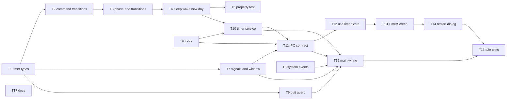

# Epic — focus-timer-core

> **Spec:** [spec.md](../spec.md) · **Design:** [sad.md](../sad.md) · **Data model:** [data-model.md](../data-model.md) · **API:** [public-api.md](../contracts/public-api.md) (typed IPC; no OpenAPI) · **ADRs:** [adr/](../adr/)

## Goal

Ship a dependable, manually advanced Pomodoro cycle (25 / 5 / 15, long break after 4 completed
focus sessions) whose rules live in main as one pure transition function. Every phase end is
signalled even with the window hidden or closed, and only completed focus sessions advance the
cycle. This delivers spec §2: run a whole working day on this timer, never miss a phase end, and
keep an honest cycle count for the later Statistics step.

## Scope

- **In:** `src/shared/timer.ts` rules + property test; main shell (`clock`, `signals`, `window`, `system-events`, `quit-guard`, `timer-service`, `ipc`, `index`); typed IPC contract + preload; renderer `useTimerState` + `TimerScreen` + `Button` / `Dialog` primitives; `electron-builder.yml` App Nap opt-out; e2e timing tests; repo ADR-0002 note + on-device checklist.
- **Out:** the Session-end ritual, configurable durations, history/statistics, surviving a quit, a menu-bar icon (spec §3). No persisted data and no store migration (data-model.md: no schema change).

## Task map

**Waves** (parallel within a wave): 1 — T1, T6, T8, T17 · 2 — T2, T7, T9 · 3 — T3 · 4 — T4 · 5 — T5, T10 · 6 — T11 · 7 — T12, T15 · 8 — T13 · 9 — T14 · 10 — T16.

**Lanes:** T1→T4 share `src/shared/timer.ts` (one serialized chain). T11 is a compile-coupled contract task (`InvokeContract` → `Api` / `Handlers` in shared, main and preload land together) and shares `src/main/index.ts` with T15. T13/T14 share `TimerScreen.tsx`. T13/T16 share `e2e/boot.spec.ts`.

## Tasks

See [tracker.md](./tracker.md) for status. Machine contract: [tasks.json](../tasks.json).

| # | Task | Layer | Blocked by | DoD (short) |
|---|---|---|---|---|
| T1 | [Timer types, default config, snapshot helpers](./t01-timer-types-and-helpers.md) | domain | — | helper tests incl. all 12 AC-02b cells pass |
| T2 | [Command transitions with revision targeting](./t02-command-transitions.md) | domain | T1 | a test per AC-02/02b/04/10/11/12 passes |
| T3 | [Deadline transition: phase end, cycle, notice, effects](./t03-phase-end-transitions.md) | domain | T2 | AC-05…09 tests; one notify + one bounce per end |
| T4 | [Sleep, wake, new-day, clock-change transitions](./t04-sleep-wake-new-day-transitions.md) | domain | T3 | every AC-14/AC-15 branch tested |
| T5 | [Command-safety property test (10,000 sequences)](./t05-command-safety-property-test.md) | tests | T4 | 0 invariant violations in `npm test` |
| T6 | [Clock adapter](./t06-clock-adapter.md) | infra | — | clock tests incl. DST pass |
| T7 | [Phase-end signals + single hide-on-close window](./t07-signals-and-single-window.md) | infra | T1 | signals/window tests pass with mocked Electron |
| T8 | [System events adapter](./t08-system-events-adapter.md) | infra | — | event → callback tests pass |
| T9 | [Quit guard](./t09-quit-guard.md) | app | T1 | confirm/cancel/empty/OS-quit tests pass |
| T10 | [Timer service](./t10-timer-service.md) | app | T4, T6 | one timeout, effects + broadcast on fire |
| T11 | [IPC timer contract (shared + main + preload)](./t11-ipc-timer-contract.md) | ports | T6, T7, T10 | typecheck green across processes; registrar tests |
| T12 | [useTimerState hook](./t12-use-timer-state-hook.md) | ui | T11 | highest-revision + first-visible-frame tests |
| T13 | [TimerScreen + Button](./t13-timer-screen.md) | ui | T12 | AC-01/02b/06 render tests; boot e2e updated |
| T14 | [Restart-cycle dialog + Dialog](./t14-restart-cycle-dialog.md) | ui | T13 | confirm/cancel/stale/nothing-to-lose tests |
| T15 | [Main wiring + App Nap opt-out](./t15-main-wiring.md) | wiring | T7, T8, T9, T10, T11 | app boots; `NSAppSleepDisabled` true in Info.plist |
| T16 | [E2E: launch, control latency, hidden phase end](./t16-e2e-timer-flows.md) | tests | T14, T15 | ≤2 s launch, ≤100 ms controls, ≤1 s phase end |
| T17 | [Repo ADR-0002 note + device checklist](./t17-docs-adr-note-and-device-checklist.md) | docs | — | note added; `verification.md` lists every manual check |

## Risks / Hard rules

- **`src/shared` stays pure** — no Electron, DOM, React or `node:` imports, and the rules never read a clock (CLAUDE.md *Process boundary*; sad §2).
- **Channel strings only in `src/shared/ipc.ts`**; handlers only in `src/main/ipc.ts`; expected failures are `CommandOutcome` values, `Result.ok: false` only for unexpected throws (CLAUDE.md *IPC contract*).
- **Renderer hardening fixed**: `contextIsolation: true`, `nodeIntegration: false`, `sandbox: true` (sad §2).
- **One timeout, no interval in main** (ADR-0003); App Nap disabled in the bundle (ADR-0004). Background NFRs are checked on the **packaged** app only (sad §7).
- **Nothing persisted** — no store file, schema version or migration (spec §3; data-model.md).
- **Open on-device risks** (sad §11): late `suspend`, App Nap not the only throttle, clock/time-zone notifications reaching main, `shutdown` before quit on logout — tracked by T17's checklist and decided before the first public release.
