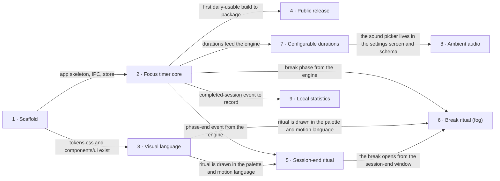

# Roadmap — pomodoro-timer

> **A decomposition, not a promise.** The overall idea broken into incremental steps: what each
> step is, where it comes from, how big it is — or that nobody has looked at it yet — and in which
> order, and parallel lanes, we walk them. **No dates** (except shipped history), **no scores** —
> order is the prioritization. The *solution* for any step lives in its `docs/features/<slug>/`
> spec, not here.

## Destination

The owner opens a free, open-source macOS Pomodoro timer every working day, because its session
end and its break feel like a calm, well-designed ritual rather than a system alert.

## Steps

| # | Step | Source | Size | Status |
|---|---|---|:---:|---|
| 1 | Scaffold — the Electron + React + TypeScript skeleton boots, with tests, lint, IPC bridge, JSON store and design tokens in place | architecture-map.md §Module inventory | M | idea |
| 2 | [Focus timer core](features/focus-timer-core/) — start, pause and reset a focus session that cycles into short and long breaks; the engine lives in main, a basic timer screen shows it | idea-brief.md §2 Problem | M | building |
| 3 | Visual language — the palette (light and dark) and the motion language the rituals are built from, set as the design canon and the tokens | idea-brief.md §2 Problem | S | idea |
| 4 | Public release — an unsigned `.dmg` on GitHub Releases, an open-source licence, and README install steps through Open Anyway | idea-brief.md §7 Recommendation | S | idea |
| 5 | Session-end ritual — when a focus session ends, the app's own window gently appears with animation and a chime; a native notification is the fallback | idea-brief.md §7 Recommendation | M | idea |
| 6 | Break ritual → see [Not yet specified](#not-yet-specified) | idea-brief.md §7 Recommendation | fog | idea |
| 7 | Configurable durations — a settings screen and settings schema for focus, short-break and long-break lengths | idea-brief.md §7 Recommendation | S | idea |
| 8 | Ambient audio — loopable ambient sound (rain, café, noise) chosen in settings and played during sessions | idea-brief.md §7 Recommendation | S | idea |
| 9 | Local statistics — completed sessions are recorded to `history.json` and a stats screen shows them | idea-brief.md §7 Recommendation | M | idea |

## Not yet specified

| Area | What we'd have to learn | Blocks | How it gets sharpened |
|---|---|:---:|---|
| The break experience | The brief says only that the break "happens inside the app's window". Nobody has said what the user does or sees there (a guided breath, an ambient scene, a stretch prompt, a calm visual and nothing more), how the break ends, or how it hands back to the next focus session — so there is no question yet precise enough to size | 6 | Live with the Session-end ritual for a few days, then a short `/sdd:interview` pass on the break (or a throwaway prototype of two candidate breaks) |

## Out of scope

- Ads, paid tiers and payments — the app is free and open source (idea-brief.md §5).
- Windows and Linux in the first release — macOS first; deferred, not rejected (idea-brief.md §5).
- Cloud sync — history stays local in v1 (idea-brief.md §5).
- Notarization / paid code signing — v1 ships unsigned (idea-brief.md §7).
- Menu-bar icon — removed from v1 by the owner at roadmap review, although idea-brief.md §7 listed it; bringing it back is an explicit scope change.

## Open decisions

| # | Question | Type | Owner | Blocks |
|---|---|:---:|:---:|:---:|
| D1 | How gentle is the session-end window: does it take focus, does it appear over a full-screen app and on the current Space, or does it wait? (Feasible either way — `type: 'panel'` + `showInactive()`, see Decisions so far) | grilling | human | 5 |
| D2 | Which open-source licence does the repo ship under? | grilling | human | 4 |
| D3 | Does an unsigned build open on the owner's current macOS through Privacy & Security → Open Anyway, exactly as the README will describe? | prototype | human | 4 |
| D4 | Keep a per-file provenance record (source URL + CC0 confirmation) next to every bundled sound | task | agent | 5, 8 |

## Decisions so far

- Build on Electron + React + TypeScript → [`ADR-0001`](adr/0001-build-on-electron-react-typescript.md)
- The timer engine runs in the main process; the renderer only displays → [`ADR-0002`](adr/0002-run-the-timer-engine-in-the-main-process.md)
- Settings and history persist as versioned local JSON → [`ADR-0003`](adr/0003-persist-data-as-versioned-local-json.md)
- Free and open source, macOS first, no cloud sync → [`idea-brief.md §5`](idea-brief.md)
- Session end is the app's own window, with a native notification as fallback → [`idea-brief.md §7`](idea-brief.md)
- A macOS window can float over full-screen apps on every Space without taking focus (`type: 'panel'`, `showInactive()`) → [Electron BrowserWindow docs](https://www.electronjs.org/docs/latest/api/browser-window#winsetvisibleonallworkspacesvisible-options-macos-linux)
- Bundled audio comes from Freesound, CC0 sounds only; Pixabay is excluded (its licence forbids standalone redistribution) → [Freesound FAQ](https://freesound.org/help/faq/)
- The session-end chime belongs to Session-end ritual; Ambient audio covers ambience only → this roadmap, [Steps](#steps)
- Public release ships right after Focus timer core instead of waiting for the full v1 → this roadmap, [Execution path](#execution-path)
- Success = the owner uses the app every working day for 4 weeks without going back to a previous timer → [`features/focus-timer-core/spec.md` §7](features/focus-timer-core/spec.md)

## Dependency graph

## Execution path

All lanes append entries to the shared IPC contract (`src/shared/ipc.ts` (new), `src/main/ipc.ts` (new)),
and the store lanes append migration functions to `src/main/store/migrations.ts` (new). Those edits
are append-only, so lanes conflict there only trivially.

| Wave | Steps | Zone per step (why parallel-safe) | Unlocks |
|:---:|---|---|---|
| 1 | 1 | 1: whole repo skeleton `src/` (new), per `docs/features/_scaffold/tasks.json` | 2, 3 |
| 2 | 2 ∥ 3 | 2: `src/shared/timer.ts` (new) + main timer service `src/main/` (new) + `src/renderer/src/screens/` timer (new) · 3: `docs/design-system.md` (new) + `src/renderer/src/styles/tokens.css` (new) + `src/renderer/src/components/ui/` (new) — engine and screen vs. canon and tokens | 4, 5, 7, 9 |
| 3 | 4 ∥ 5 ∥ 7 | 4: `electron-builder.yml` (new) + `.github/workflows/` (new) + `LICENSE` (new) + `README.md` · 5: session-end window in `src/main/` (new) + session-end screen in `src/renderer/src/screens/` (new) · 7: settings schema in `src/main/store/` (new) + settings screen in `src/renderer/src/screens/` (new) — packaging vs. one window vs. settings | 6 (after recon), 8 |
| 4 | 8 ∥ 9 | 8: `src/renderer/src/audio/` (new) + `assets/sounds/` (new) + sound picker on step 7's settings screen · 9: history schema in `src/main/store/` (new) + stats screen in `src/renderer/src/screens/` (new) — settings vs. history | — |

Break ritual (6) is fog and enters no wave until its recon pass gives it a size; it then lands in
the first wave after Session-end ritual (5).

## Shipped

| Step | Shipped | Link |
|---|---|---|
